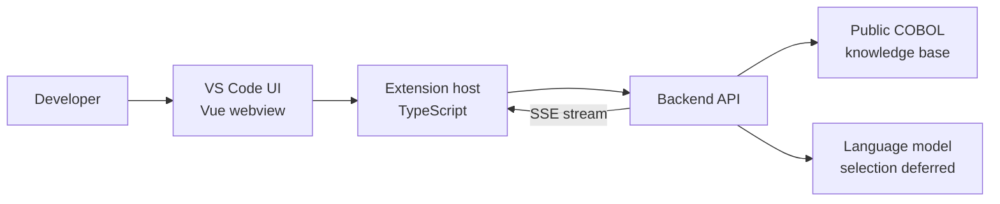

# System Design: Adaptive AI Code Assistant for COBOL

**Status:** Draft for Repo Checkpoint 1  
**Updated:** 2026-10-30

## Purpose and current state

This proof of concept helps developers understand COBOL through explanations adapted to a five-slider profile informed by GenderMag research. It is being developed with IBM Software and IBM Research advisors. The project uses public COBOL material only; IBM proprietary code, documentation, and data are out of scope.

The team has selected a VS Code extension and this frontend stack: VS Code Extension API, TypeScript, esbuild, Vue.js, and an SSE client for streamed responses. A Node-based GitHub Actions workflow is in place. As of this draft, the project does not yet have a working end-to-end product; confirm the status at the commit submitted for review.

## Planned architecture

The walking skeleton will let a developer submit a COBOL example with a profile, then view a streamed explanation in VS Code. The backend will retrieve relevant public material and generate an explanation. Backend framework, model, retrieval implementation, and hosting are undecided.

### Interfaces and data

The proposed extension request contains the user-submitted COBOL code, five profile values, and a request ID. The backend validates the request, retrieves relevant passages, and streams explanation content, source references, completion, or an error. Endpoint names, event schema, limits, and error codes are still to be defined.

Core data includes the request and profile, indexed public source passages, generated explanation and references, and evaluation cases/results. No retention or logging policy is recorded yet. Until one is agreed, use public sample code and avoid retaining submitted code or outputs.

## Deployment target

The extension is intended to run in VS Code, with a separate backend for retrieval and generation. The week-10 walking skeleton’s host and extension test/distribution channel are to be deployed by week 10 and 11. 

## Decisions and open questions

**Decided:** VS Code extension UI; TypeScript, esbuild, Vue.js, and SSE frontend direction; five-slider adaptive profile; public COBOL sources only.

**Deferred:** model/provider, backend framework and hosting, knowledge-base corpus and retrieval technology, exact slider meanings and ranges, authentication, code retention/logging, extension release channel, and evaluation measures.

Before implementation, the team needs to decide where the skeleton will run, which public sources it will cite, how profile values affect explanations, how user code is handled, and what tests demonstrate correct retrieval and request/stream behavior. Record hard-to-reverse decisions in the project’s RFC/ADR location and update this document to match the implementation.
